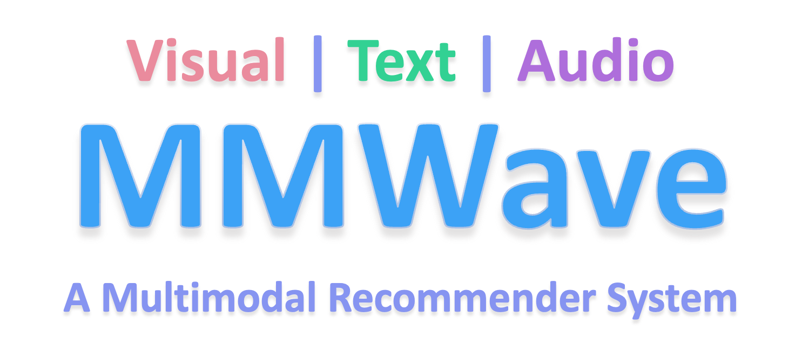
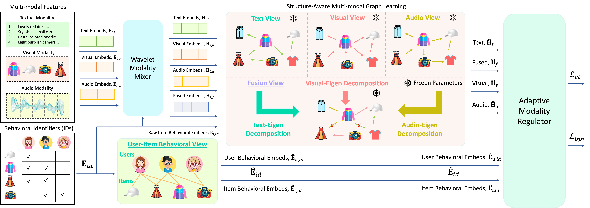
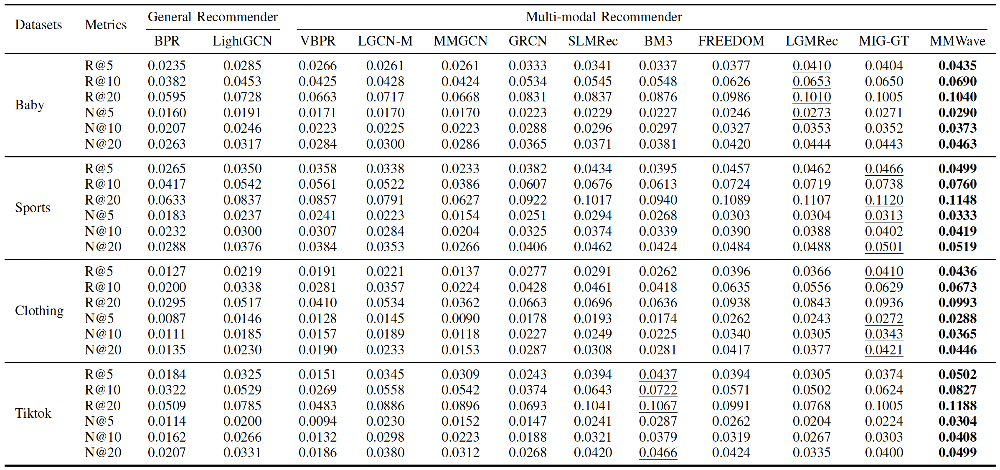

# MMWave: Tackling the Modality Inhibitance Effect with Wavelet-based Modality Integration in Multi-modal Recommendation

<!-- PROJECT LOGO -->
<br />
<div align="center">
  <a href="https://github.com/kennethorq/MMWave">
    
  </a>
</div>

## Introduction

This is the Pytorch implementation for our IEEE TKDE 2026 paper:

>**[TKDE 2026]** Rongqing Kenneth Ong, Andy W. H Khong (2026). Tackling the Modality Inhibitance Effect with Wavelet-based Modality Integration in Multi-modal Recommendation


## Enviroment Requirement
- Python 3.7
- Pytorch 1.13

## Dataset  
Download from Google Drive: [Baby/Sports/Clothing](https://drive.google.com/drive/folders/13cBy1EA_saTUuXxVllKgtfci2A09jyaG?usp=sharing)  
The data comprises text and image features extracted from Sentence-Transformers and CNN.  

## How to run
1. Place the downloaded data (e.g. `baby`) into the `data` directory.
2. Enter the `src` folder and execute the following command:  
`python main.py -m MMWave -d baby`  

Other parameters can be set either through the command line or by using the configuration files located in `configs/model/MMWave.yaml` and `configs/dataset/*.yaml`.

## Performance Comparison
<div align="center">
    
</div>


## Citation
If you find MMWave useful in your research, please consider citing our paper.
```

```
This code is made available solely for academic research purposes.


## Acknowledgement
The structure of this code is inspired by the [MMRec](https://github.com/enoche/MMRec) framework. We acknowledge and appreciate their valuable contributions.